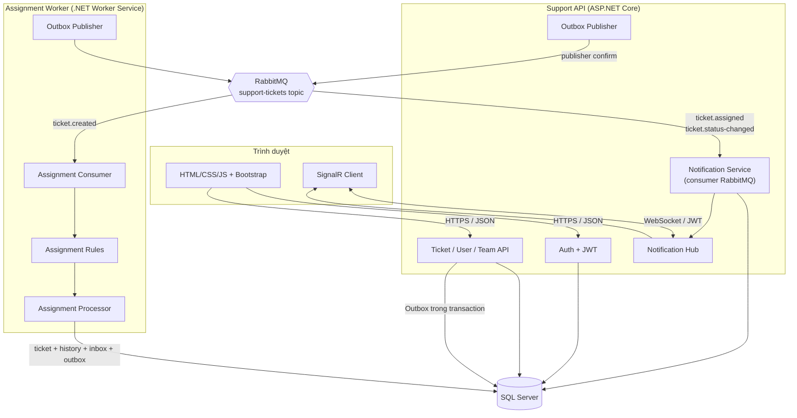

# Hệ thống tiếp nhận và xử lý yêu cầu hỗ trợ khách hàng

Website hoàn chỉnh cho phép khách hàng gửi yêu cầu hỗ trợ, hệ thống tự động phân công theo nhóm xử lý qua
RabbitMQ và Assignment Worker, cập nhật vòng đời `New → Assigned → InProgress → Resolved`, lưu đầy đủ lịch sử
và gửi thông báo realtime qua SignalR đến đúng người có quyền.

> **Trạng thái:** đã hoàn thiện toàn bộ chức năng nghiệp vụ, giao diện, xử lý nền, thông báo realtime, kiểm thử và đóng gói Docker.
> Không có AI, chatbot hay thanh toán trong phạm vi đồ án. Kế hoạch tiến độ theo chức năng nằm tại
> [docs/completion-checklist.md](docs/completion-checklist.md).

## 1. Chức năng chính

- Đăng ký công khai (luôn là **Khách hàng**), đăng nhập/đăng xuất bằng JWT, phân quyền Customer/Agent/Admin ở backend.
- Tạo yêu cầu, tra cứu danh sách có tìm kiếm/lọc/phân trang, xem chi tiết và timeline lịch sử.
- Outbox ghi sự kiện cùng transaction, gửi RabbitMQ bền vững với publisher confirm.
- Assignment Worker chạy tiến trình riêng: `Account → Kỹ thuật`, `Payment → Kế toán`, `Delivery → Chăm sóc khách hàng`, `Other → Hỗ trợ chung`;
  gán trưởng nhóm đang hoạt động, nếu chưa có nhân viên thì giao ở cấp nhóm.
- Chống xử lý trùng theo `MessageId`, retry có giới hạn, hàng đợi lỗi DLQ, không ghi đè phân công thủ công.
- SignalR gửi thông báo cho người tạo, người xử lý và thành viên nhóm; loại trừ người vừa thực hiện thay đổi.
- Admin quản lý tài khoản, vai trò, nhóm xử lý, thành viên nhóm và phân công lại.
- Giao diện tiếng Việt, responsive, có trạng thái tải/rỗng/lỗi/thành công, thông báo realtime và trạng thái kết nối.

## 2. Kiến trúc



- **Support API** phục vụ REST API và giao diện tĩnh, đồng thời chạy Notification Service và SignalR Hub trong cùng tiến trình.
- **Assignment Worker** là tiến trình riêng, có thể scale độc lập.
- **RabbitMQ** dùng topic exchange `support-tickets`; queue chính, retry queue có TTL và DLQ.
- **SQL Server** lưu dữ liệu nghiệp vụ, Outbox/Inbox và lịch sử.
- Chi tiết luồng, bảng, quyết định thiết kế: [docs/architecture.md](docs/architecture.md).

## 3. Công nghệ

| Thành phần | Phiên bản |
|---|---|
| .NET SDK / ASP.NET Core | 10.0.403 / `net10.0` |
| EF Core + SQL Server provider | 10.0.14 |
| SQL Server (Docker) | 2022 Developer |
| RabbitMQ | 4.4.x management |
| RabbitMQ.Client | 7.2.2 |
| SignalR | ASP.NET Core 10 + JS client 8.0.17 (vendor cục bộ) |
| Giao diện | HTML, CSS, JavaScript thuần + Bootstrap 5.3.8 (vendor cục bộ) |
| Kiểm thử | xUnit 2.9.3, Microsoft.AspNetCore.Mvc.Testing, Playwright |
| Đóng gói | Docker Compose |

## 4. Yêu cầu môi trường

- Docker Desktop (Linux containers) và Docker Compose v2+.
- Git; .NET 10 SDK nếu chạy API/Worker ngoài Docker hoặc chạy test.
- Node.js 20+ nếu chạy kịch bản E2E/UI.
- Cổng trống: `5026` (API, đổi được qua `API_PORT`), `1433`, `5672`, `15672`.

## 5. Chạy nhanh bằng Docker Compose

### 5.1. Cấu hình bí mật cục bộ

```bash
cp .env.example .env
```

Mở `.env` và thay **toàn bộ** giá trị mẫu. Có thể tạo bí mật ngẫu nhiên:

```bash
# Khóa JWT (tối thiểu 32 byte)
openssl rand -base64 48

# Mật khẩu SQL Server / RabbitMQ / tài khoản demo (mỗi giá trị một lần chạy)
openssl rand -base64 24
```

Các biến bắt buộc:

| Biến | Ý nghĩa |
|---|---|
| `MSSQL_SA_PASSWORD` | Mật khẩu `sa` của SQL Server (đủ mạnh, ≥ 8 ký tự) |
| `RABBITMQ_USER`, `RABBITMQ_PASSWORD` | Tài khoản RabbitMQ |
| `JWT_KEY` | Khóa ký JWT, tối thiểu 32 byte |
| `DEMO_PASSWORD` | Mật khẩu chung cho các tài khoản seed (chỉ demo) |
| `API_PORT` | Cổng truy cập website, mặc định `5026` |

File `.env` đã nằm trong `.gitignore`, không được commit.

### 5.2. Khởi động

```bash
docker compose up -d --build
docker compose ps
```

Chờ `support-ticket-sqlserver`, `support-ticket-rabbitmq`, `support-ticket-api` ở trạng thái **healthy**.
Worker không có HTTP nhưng phải ở trạng thái **Up**.

Truy cập:

| Dịch vụ | URL |
|---|---|
| Website | <http://localhost:5026/> (tự chuyển tới trang đăng nhập nếu chưa đăng nhập) |
| Health check | <http://localhost:5026/health> |
| Thông tin API | <http://localhost:5026/api/info> |
| RabbitMQ Management | <http://localhost:15672> (user/mật khẩu trong `.env`) |

Lần chạy đầu tiên API tự áp dụng migration và seed dữ liệu. Sau đó dữ liệu được giữ trong volume
`sqlserver-data`/`rabbitmq-data` và tồn tại qua mọi lần khởi động lại.

### 5.3. Tài khoản demo

Mật khẩu của tất cả tài khoản seed là giá trị `DEMO_PASSWORD` trong `.env`:

| Vai trò | Email |
|---|---|
| Quản trị viên | `admin@support.local` |
| Nhân viên Kỹ thuật (trưởng nhóm) | `agent.tech@support.local` |
| Nhân viên Kế toán | `agent.acct@support.local` |
| Nhân viên Chăm sóc khách hàng | `agent.cskh@support.local` |
| Nhân viên Hỗ trợ chung | `agent.general@support.local` |
| Khách hàng | `customer@support.local` |
| Khách hàng thứ hai (kiểm tra cô lập dữ liệu) | `customer2@support.local` |

Có thể tự tạo tài khoản Khách hàng mới tại trang **Tạo tài khoản**. Tài khoản đăng ký công khai luôn có vai trò
Customer; Admin cấp vai trò nhân viên/quản trị trong trang quản trị.

Seed dữ liệu chạy lại được nhiều lần mà không nhân bản. Dữ liệu demo gồm 4 nhóm, 7 tài khoản và 6 ticket
`TK-DEMO-001…006` ở các trạng thái khác nhau.

> Nếu database đã tồn tại từ lần chạy trước, mật khẩu của tài khoản seed **không bị đổi** theo `.env` mới.
> Muốn làm lại toàn bộ dữ liệu: `docker compose down -v` (xóa volume — **mất toàn bộ dữ liệu**) rồi
> `docker compose up -d --build`.

### 5.4. Dừng hệ thống

```bash
docker compose down          # giữ dữ liệu
docker compose down -v       # xóa cả volume dữ liệu (chỉ khi muốn làm lại)
```

## 6. Chạy API/Worker ngoài Docker (phát triển)

```bash
# 1. Chỉ khởi động hạ tầng
docker compose up -d sqlserver rabbitmq

# 2. Nạp biến môi trường (Git Bash)
set -a && . ./.env && set +a
export ConnectionStrings__DefaultConnection="Server=localhost,1433;Database=SupportTicketDb;User Id=sa;Password=$MSSQL_SA_PASSWORD;TrustServerCertificate=True;Encrypt=False;MultipleActiveResultSets=True"
export RabbitMq__UserName="$RABBITMQ_USER"
export RabbitMq__Password="$RABBITMQ_PASSWORD"
export Seed__DefaultPassword="$DEMO_PASSWORD"
export Jwt__Key="$JWT_KEY"

# 3. Terminal 1
dotnet run --project src/SupportTicket.Api

# 4. Terminal 2 (cùng biến ConnectionStrings + RabbitMq)
dotnet run --project src/SupportTicket.Worker
```

PowerShell: dùng `$env:ConnectionStrings__DefaultConnection="..."`, `$env:RabbitMq__UserName="..."`, v.v.

Ở môi trường Development, nếu thiếu `Jwt__Key`, API sinh khóa tạm và ghi cảnh báo; token sẽ mất hiệu lực
sau khi khởi động lại. Không dùng cơ chế này cho production.

### Migration

API tự chạy migration khi khởi động (có retry chờ SQL Server), không xóa dữ liệu hiện có.
Thao tác thủ công:

```bash
dotnet tool install --global dotnet-ef --version 10.0.14
dotnet ef migrations list --project src/SupportTicket.Infrastructure --startup-project src/SupportTicket.Infrastructure
dotnet ef migrations add <TenMigration> --project src/SupportTicket.Infrastructure --startup-project src/SupportTicket.Infrastructure --output-dir Data/Migrations
dotnet ef database update --project src/SupportTicket.Infrastructure --startup-project src/SupportTicket.Infrastructure
```

## 7. Kiểm thử

### 7.1. Build và xUnit

```bash
dotnet build SupportTicket.sln

# Chỉ unit test (không cần SQL Server)
dotnet test SupportTicket.sln

# Đầy đủ unit + tích hợp với SQL Server thật
set -a && . ./.env && set +a
RUN_INTEGRATION_TESTS=1 dotnet test SupportTicket.sln
```

Test tích hợp tự tạo database `SupportTicketTest_<random>`, tắt RabbitMQ/Outbox consumer, kiểm tra API thật rồi
xóa database test. Không chạm database phát triển. Kết quả gần nhất: **47/47 đạt**.

### 7.2. E2E RabbitMQ + Worker + SignalR

Yêu cầu stack Docker đang chạy:

```bash
cd tools/e2e
npm install
set -a && . ../../.env && set +a
DEMO_PASSWORD="$DEMO_PASSWORD" RABBITMQ_USER="$RABBITMQ_USER" RABBITMQ_PASSWORD="$RABBITMQ_PASSWORD" \
  node realtime-e2e.mjs
```

Kịch bản kiểm tra tạo ticket → phân công thật → nhân viên xử lý → khách hàng nhận realtime → Resolved,
đồng thời xác nhận khách hàng khác không nhận thông báo.

### 7.3. UI Playwright

```bash
cd tools/ui-check
npm install
npx playwright install chromium
set -a && . ../../.env && set +a
DEMO_PASSWORD="$DEMO_PASSWORD" node ui-check.mjs
```

Kịch bản đăng ký, đăng nhập, tạo ticket, dashboard, quản trị (tạo nhóm/thành viên), realtime, tìm kiếm và
responsive. Ảnh chụp được lưu tại [docs/screenshots](docs/screenshots).

Kết quả kiểm thử thực tế và các tình huống độ tin cậy: [docs/test-report.md](docs/test-report.md).

## 8. API và phân quyền

- Danh sách đầy đủ, request/response mẫu, ma trận quyền, SignalR: [docs/api.md](docs/api.md).
- Postman collection (không chứa token thật): [postman/SupportTicket.postman_collection.json](postman/SupportTicket.postman_collection.json)
  và environment mẫu [postman/SupportTicket.postman_environment.json](postman/SupportTicket.postman_environment.json).
- Năm API bắt buộc:

| Method | Đường dẫn | Quyền |
|---|---|---|
| `POST` | `/tickets` (alias `/api/tickets`) | Đã đăng nhập |
| `GET` | `/tickets` | Đã đăng nhập, tự lọc theo quyền |
| `GET` | `/tickets/{id}` | Người tạo / người xử lý / thành viên nhóm / Admin |
| `PATCH` | `/tickets/{id}/status` | Agent được giao hoặc thuộc nhóm / Admin |
| `GET` | `/users/{userId}/tickets` | Chính mình hoặc Admin |

Mọi lỗi trả `application/problem+json`; dữ liệu động trong giao diện được render bằng `textContent`
để tránh chèn HTML/script.

## 9. Cấu hình

| Khóa cấu hình | Mặc định | Ghi chú |
|---|---|---|
| `ConnectionStrings:DefaultConnection` | — | Bắt buộc khi chạy ngoài compose; có thể dựng từ `MSSQL_SA_PASSWORD` |
| `Jwt:Key` | — | Bắt buộc ở Production; Development sinh tạm nếu thiếu |
| `Jwt:Issuer` / `Jwt:Audience` | `SupportTicket.Api` / `SupportTicket.Client` | |
| `Jwt:ExpiryMinutes` | `120` | |
| `RabbitMq:Enabled` | `true` | Tắt trong test |
| `RabbitMq:Host/Port/VirtualHost` | `localhost` / `5672` / `/` | Compose dùng `rabbitmq` |
| `RabbitMq:UserName/Password` | — | Lấy từ `.env` |
| `Outbox:Enabled` | `true` | Bật tiến trình gửi Outbox |
| `Outbox:PollSeconds` / `BatchSize` | `2` / `20` | |
| `Notifications:ConsumerEnabled` | `true` | Consumer SignalR trong API |
| `Seed:DefaultPassword` | — | Mật khẩu tài khoản demo |
| `Seed:IncludeDemoTickets` | `true` | Seed 6 ticket mẫu |
| `Cors:AllowedOrigins` | `http://localhost:5026`, `http://localhost:5080` | Giao diện cùng origin không cần CORS |

Không đặt bí mật trong `appsettings.json`. Compose truyền cấu hình qua biến môi trường từ `.env`.

## 10. Cấu trúc thư mục

```text
.
├── SupportTicket.sln
├── docker-compose.yml
├── .env.example
├── src/
│   ├── SupportTicket.Api/            # REST API, SignalR Hub, Notification consumer, wwwroot
│   ├── SupportTicket.Worker/         # Assignment Worker
│   ├── SupportTicket.Infrastructure/ # Entity, DbContext, migration, Outbox, RabbitMQ, rules
│   └── SupportTicket.Contracts/      # Enum, sự kiện, tên exchange/queue
├── tests/SupportTicket.Tests/        # Unit + integration test
├── tools/e2e/                        # E2E RabbitMQ + SignalR
├── tools/ui-check/                   # Playwright UI check
├── postman/                          # Collection + environment mẫu
├── docs/
│   ├── completion-checklist.md       # Trạng thái theo chức năng
│   ├── api.md
│   ├── architecture.md
│   ├── business-rules.md
│   ├── requirements.md
│   ├── test-report.md
│   ├── demo-script.md
│   └── screenshots/
└── README.md
```

## 11. Bảo mật và vận hành

- Mật khẩu băm bằng `PasswordHasher<User>`, không trả hash qua API.
- Danh tính lấy từ JWT (`NameIdentifier`), client không gửi được `RequesterId`/`userId` thay cho mình.
- Mỗi request có token đều kiểm tra tài khoản còn `IsActive`.
- Quyền được kiểm tra ở backend; giao diện chỉ ẩn/hiện nút.
- SignalR yêu cầu JWT; server tự thêm group theo user/team, client không có hàm join nhóm tùy ý.
- Không broadcast mô tả ticket; payload thông báo chỉ gồm mã, tiêu đề, trạng thái, nhóm, người xử lý, thời điểm.
- RabbitMQ dùng message persistent, publisher confirm, retry queue TTL và DLQ; Outbox được gửi lại khi broker gián đoạn.
- Lỗi API trả ProblemDetails, không trả stack trace.
- Log có TicketId/MessageId; không log mật khẩu/token.

## 12. Xử lý sự cố

| Hiện tượng | Cách xử lý |
|---|---|
| API chưa healthy | `docker compose logs api --tail 100`; kiểm tra mật khẩu SQL/Rabbit trong `.env` |
| Sai mật khẩu tài khoản demo | Mật khẩu seed chỉ áp dụng khi tạo mới; dùng `docker compose down -v` nếu chấp nhận xóa dữ liệu, hoặc Admin đặt lại mật khẩu |
| `port is already allocated` | Đổi `API_PORT`/`SQLSERVER_PORT`/`RABBITMQ_AMQP_PORT` trong `.env` |
| Worker không phân công | Kiểm tra RabbitMQ healthy, `docker compose logs worker`, queue `assignment-worker` và DLQ |
| Message lỗi | Xem `assignment-worker.dlq`/`notification-service.dlq` trong RabbitMQ Management; log worker có MessageId |
| SignalR báo mất kết nối | Giao diện tự kết nối lại; khi có mạng lại trang tải lại dữ liệu qua API |
| Ticket mới không có nhóm | Nhóm đích có thể đã bị ngừng hoạt động; kiểm tra trang quản trị hoặc DLQ |
| Build bị khóa file DLL | Dừng API/Worker đang chạy rồi build lại |

## 13. Phạm vi và hạn chế

- Không có AI/chatbot/thanh toán, không có đính kèm tệp, email/SMS, SLA nâng cao hay đa tổ chức.
- Chưa có refresh token/thu hồi token tức thời; token hết hạn theo `Jwt:ExpiryMinutes`.
- Outbox publisher chạy ở API và Worker; chống trùng dựa trên Inbox + trạng thái ticket. Đa instance quy mô lớn
  nên bổ sung khóa hàng khi lấy Outbox.
- SignalR chưa có Redis backplane; phù hợp một instance API trong phạm vi đồ án.
- Chưa kiểm thử tải 10.000 ticket; chưa có CI GitHub Actions.
- Bản demo chạy HTTP cục bộ; khi triển khai thật cần HTTPS và thêm rate limit đăng nhập. CORS đã giới hạn theo `Cors:AllowedOrigins`.
- Chi tiết và việc còn lại: [docs/completion-checklist.md](docs/completion-checklist.md).

## 14. Tài liệu

- [Checklist hoàn thiện](docs/completion-checklist.md)
- [API và phân quyền](docs/api.md)
- [Kiến trúc, luồng dữ liệu](docs/architecture.md)
- [Quy trình và quy tắc nghiệp vụ](docs/business-rules.md)
- [Yêu cầu hệ thống](docs/requirements.md)
- [Báo cáo kiểm thử](docs/test-report.md)
- [Kịch bản demo](docs/demo-script.md)
- [Báo cáo tuần 1 (lịch sử)](docs/progress/week-01.md)
