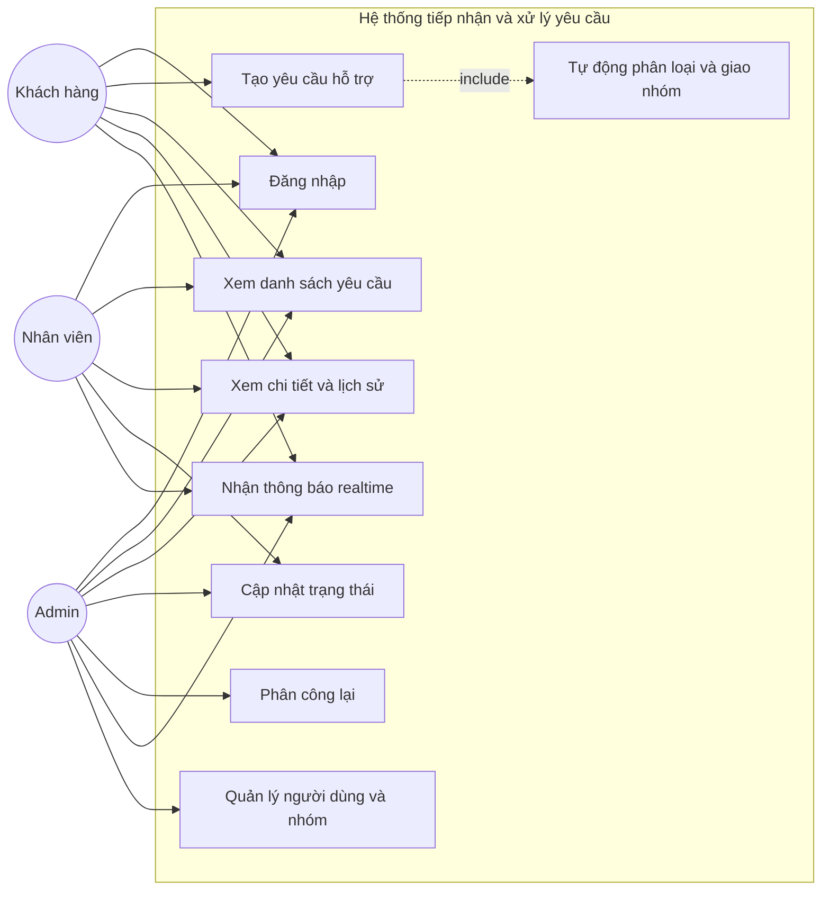
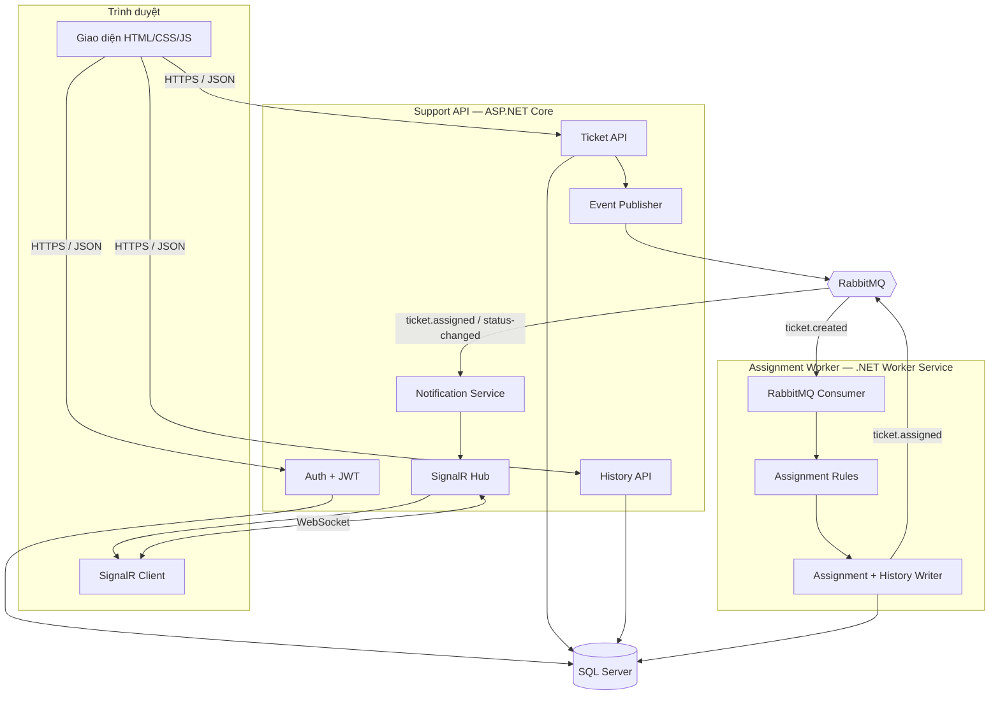
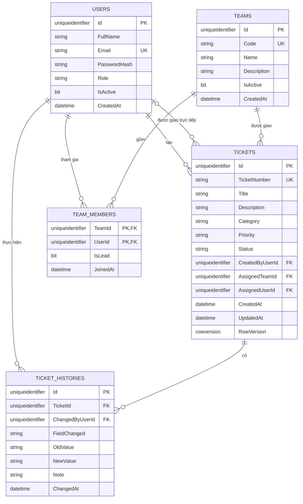
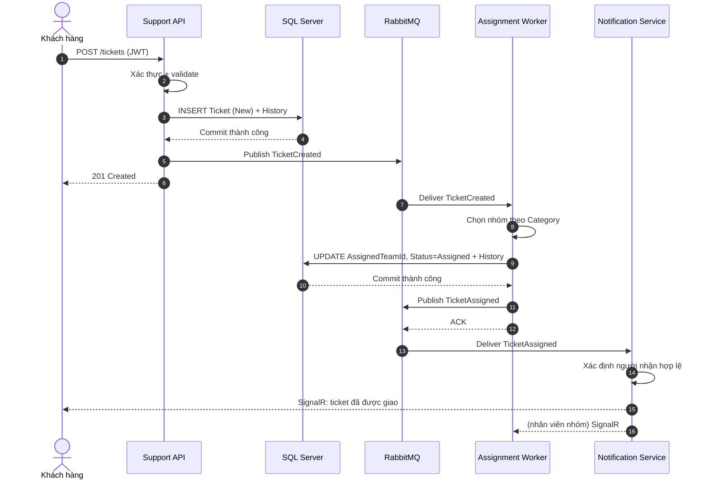
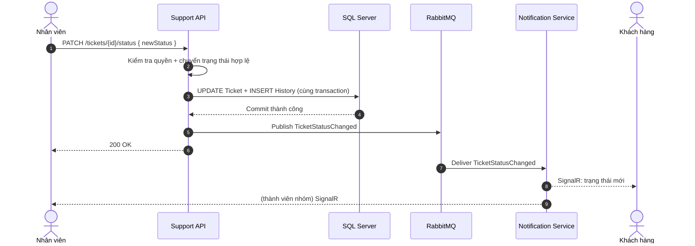
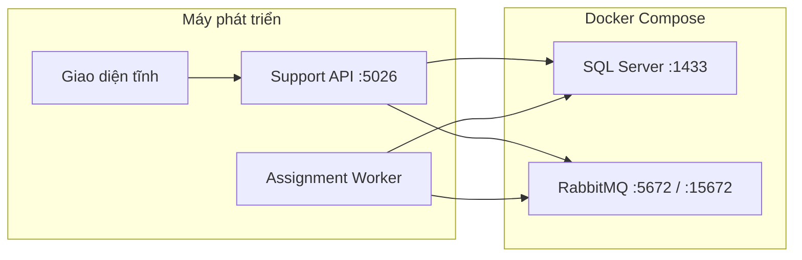

# W1-03 — Use Case, ERD và kiến trúc hệ thống

> Tài liệu thiết kế ban đầu. Các thành phần đánh dấu “tuần 3”, “tuần 6” sẽ được hiện thực theo kế hoạch.

## 1. Sơ đồ Use Case

## 2. Kiến trúc thành phần

Ghi chú:

- Notification Service và SignalR Hub chạy cùng tiến trình Support API.
- Assignment Worker chạy tiến trình riêng, có thể scale ngang.
- Hai thành phần dùng chung project `SupportTicket.Contracts` cho hợp đồng thông điệp (tuần 3).

## 3. ERD

Bảng `OUTBOX_MESSAGES` (bổ sung ở tuần 6, chưa có trong migration tuần 2):

| Trường | Kiểu | Ý nghĩa |
|---|---|---|
| `Id` | uniqueidentifier | Khóa chính, cũng là `MessageId` |
| `EventType` | nvarchar(100) | `TicketCreated`, `TicketAssigned`, `TicketStatusChanged` |
| `Payload` | nvarchar(max) | JSON của sự kiện |
| `OccurredAt` | datetime2 | Thời điểm tạo sự kiện (UTC) |
| `ProcessedAt` | datetime2 NULL | Thời điểm gửi thành công |
| `RetryCount` | int | Số lần thử |
| `Error` | nvarchar(2000) NULL | Lỗi gần nhất |

### 3.1. Ràng buộc và index chính

| Bảng | Ràng buộc/index |
|---|---|
| `USERS` | Unique `Email`; `Role` lưu dạng chuỗi, kiểm tra ở tầng ứng dụng |
| `TEAMS` | Unique `Code` (`TECH`, `ACCT`, `CSKH`, `GENERAL`) |
| `TEAM_MEMBERS` | PK tổ hợp `(TeamId, UserId)`; FK tới `Users`, `Teams` |
| `TICKETS` | Unique `TicketNumber`; index `(Status, AssignedTeamId)`; index `(CreatedByUserId, CreatedAt)`; index `(AssignedUserId, CreatedAt)` |
| `TICKET_HISTORIES` | Index `(TicketId, ChangedAt)`; FK `TicketId`, `ChangedByUserId` |
| `OUTBOX_MESSAGES` | Index `(ProcessedAt, OccurredAt)` |

### 3.2. Quan hệ và hành vi xóa

- Không có API xóa ticket/người dùng trong phạm vi đồ án.
- `Tickets.CreatedByUserId`: `ON DELETE RESTRICT`.
- `Tickets.AssignedTeamId`, `AssignedUserId`: nullable, `ON DELETE SET NULL` nếu về sau có xóa mềm.
- `TicketHistories.ChangedByUserId`: nullable (thay đổi do hệ thống), `ON DELETE SET NULL`.
- `TeamMembers`: xóa theo cặp khóa ngoại khi gỡ thành viên khỏi nhóm.

## 4. Luồng tuần tự

### 4.1. Tạo ticket, phân công và thông báo

### 4.2. Nhân viên cập nhật trạng thái

## 5. Triển khai với Docker Compose

- SQL Server và RabbitMQ chạy trong Docker ở tuần 1.
- API/Worker chạy trực tiếp bằng `dotnet run` khi phát triển.
- Tuần 7 đóng gói cả API, Worker, giao diện vào Docker Compose.

## 6. Hợp đồng API dự kiến

| Method | Đường dẫn | Quyền | Mô tả |
|---|---|---|---|
| `POST` | `/auth/login` | Công khai | Đăng nhập, trả JWT |
| `POST` | `/tickets` | Đã đăng nhập | Tạo ticket |
| `GET` | `/tickets` | Đã đăng nhập | Danh sách có phân trang/lọc theo quyền |
| `GET` | `/tickets/{id}` | Theo quyền | Chi tiết ticket |
| `GET` | `/tickets/{id}/history` | Theo quyền | Lịch sử thay đổi |
| `PATCH` | `/tickets/{id}/status` | Staff/Admin phù hợp | Chuyển trạng thái |
| `PATCH` | `/tickets/{id}/assignment` | Admin | Phân công lại nhóm/người |
| `GET` | `/users/{userId}/tickets` | Theo quyền | Ticket của người dùng |
| `GET` | `/teams` | Staff/Admin | Danh sách nhóm |
| `GET` | `/health` | Công khai | Kiểm tra API sống |
| `GET` | `/api/info` | Công khai | Thông tin phiên bản dịch vụ (tuần 1) |

Quy ước chung:

- JSON camelCase, thời gian ISO-8601 UTC.
- Lỗi dùng `ProblemDetails` (`application/problem+json`).
- Phân trang trả `items`, `page`, `pageSize`, `totalItems`, `totalPages`.
- `201 Created` kèm header `Location` khi tạo ticket.

## 7. Quyết định thiết kế

| Quyết định | Lý do | Đánh đổi |
|---|---|---|
| API và Notification cùng tiến trình | Giảm số thành phần phải triển khai, đủ cho đồ án | Không scale độc lập; chấp nhận được |
| Worker chạy riêng | Thể hiện xử lý nền, có thể scale và retry độc lập | Cần RabbitMQ và theo dõi log riêng |
| RabbitMQ topic exchange | Định tuyến linh hoạt theo loại sự kiện | Cấu hình phức tạp hơn queue đơn |
| SQL Server + EF Core | Quen thuộc, transaction và migration tốt | Cần Docker/RAM cho SQL Server |
| Outbox ở tuần 6 | Tránh mất sự kiện khi DB đã commit | Tăng độ phức tạp, cần job gửi lại |
| Idempotency theo `MessageId`/trạng thái ticket | Chống xử lý trùng khi RabbitMQ giao lại | Cần kiểm tra trong transaction |
| JWT stateless | Phù hợp SPA, dễ kiểm thử | Khó thu hồi token ngay lập tức |
| SignalR group theo user/team | Chỉ gửi đúng người có quyền | Phải quản lý group khi kết nối/ngắt |

## 8. Bảo mật

- Mật khẩu hash bằng `PasswordHasher<User>`; không trả hash qua API.
- JWT ký HMAC-SHA256, khóa lấy từ `JWT__Key` (biến môi trường) hoặc user-secrets.
- Access token thời hạn ngắn (dự kiến 60 phút), không có refresh token trong phạm vi đồ án.
- Kiểm tra quyền ở từng endpoint; không dựa vào việc ẩn nút trên giao diện.
- SignalR xác thực bằng cùng JWT; server tự chọn group, client không được tự đăng ký group tùy ý.
- Giới hạn CORS theo origin của giao diện; production bắt buộc HTTPS.
- Không log mật khẩu, token, chuỗi kết nối đầy đủ.

## 9. Hướng mở rộng (ngoài 7 tuần)

- Refresh token và thu hồi phiên.
- Đính kèm tệp, bình luận nội bộ, SLA và leo thang tự động.
- Dashboard thống kê, báo cáo thời gian xử lý.
- Tách Notification Service thành tiến trình riêng.
- Redis backplane cho SignalR khi scale nhiều instance API.
