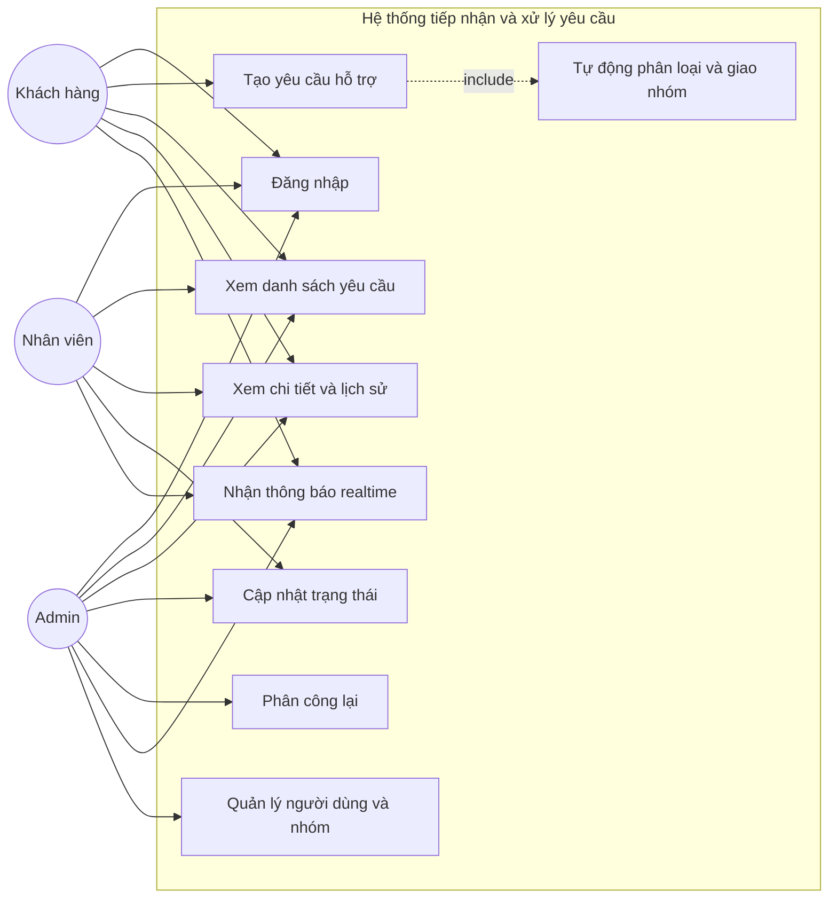
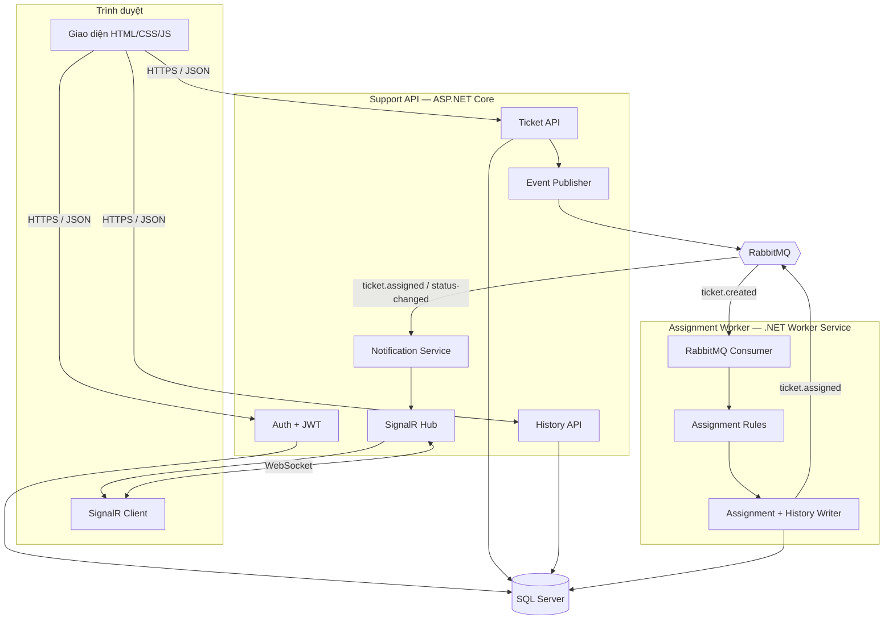
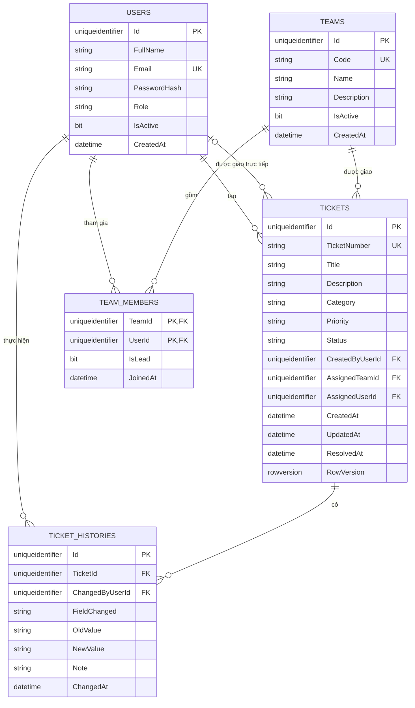
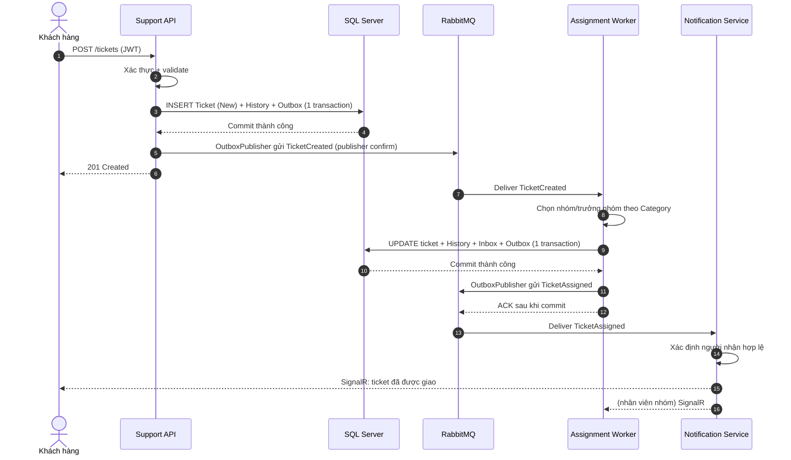
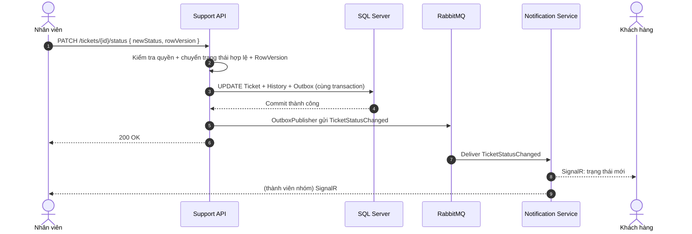
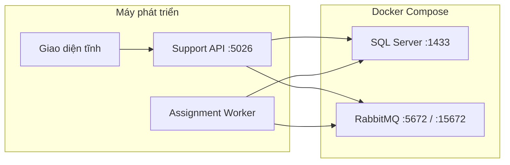

# W1-03 — Use Case, ERD và kiến trúc hệ thống

> Tài liệu thiết kế ban đầu, đã cập nhật ngày 2026-11-23 theo hiện trạng triển khai.
> Toàn bộ thành phần mô tả dưới đây đã được hiện thực; trạng thái chi tiết tại
> [completion-checklist.md](completion-checklist.md), API tại [api.md](api.md), kiểm thử tại [test-report.md](test-report.md).

## 1. Sơ đồ Use Case

## 2. Kiến trúc thành phần

Ghi chú:

- Notification Service và SignalR Hub chạy cùng tiến trình Support API.
- Assignment Worker chạy tiến trình riêng, có thể scale ngang.
- API và Worker đều có Outbox Publisher; sự kiện được ghi cùng transaction nghiệp vụ trước khi gửi RabbitMQ.
- Hai tiến trình dùng chung `SupportTicket.Contracts` (enum, sự kiện, tên exchange/queue) và `SupportTicket.Infrastructure`.
- Notification consumer dùng `Clients.Users` sau khi xác định người nhận từ dữ liệu ticket/nhóm ở server.

## 3. ERD

Bảng `OUTBOX_MESSAGES` (đã có trong migration `InitialCreate`):

| Trường | Kiểu | Ý nghĩa |
|---|---|---|
| `Id` | uniqueidentifier | Khóa chính, cũng là `MessageId` |
| `EventType` | nvarchar(100) | `TicketCreated`, `TicketAssigned`, `TicketStatusChanged` |
| `Payload` | nvarchar(max) | JSON của sự kiện |
| `OccurredAt` | datetime2 | Thời điểm tạo sự kiện (UTC) |
| `ProcessedAt` | datetime2 NULL | Thời điểm gửi thành công |
| `RoutingKey` | nvarchar(100) | Routing key RabbitMQ |
| `RetryCount` | int | Số lần thử |
| `NextAttemptAt` | datetime2 | Thời điểm thử lại (backoff) |
| `Error` | nvarchar(2000) NULL | Lỗi gần nhất |

Bảng `INBOX_MESSAGES` gồm `MessageId` (PK), `EventType`, `ProcessedAt`; dùng để bỏ qua message giao lại.

### 3.1. Ràng buộc và index chính

| Bảng | Ràng buộc/index |
|---|---|
| `USERS` | Unique `Email`; `Role` lưu dạng chuỗi, kiểm tra ở tầng ứng dụng |
| `TEAMS` | Unique `Code` (`TECH`, `ACCT`, `CSKH`, `GENERAL`) |
| `TEAM_MEMBERS` | PK tổ hợp `(TeamId, UserId)`; FK tới `Users`, `Teams` |
| `TICKETS` | Unique `TicketNumber`; index `(Status, AssignedTeamId)`; index `(CreatedByUserId, CreatedAt)`; index `(AssignedUserId, CreatedAt)` |
| `TICKET_HISTORIES` | Index `(TicketId, ChangedAt)`; FK `TicketId`, `ChangedByUserId` |
| `OUTBOX_MESSAGES` | Index `(ProcessedAt, NextAttemptAt)`; lưu `EventType`, `RoutingKey`, `RetryCount`, `Error` |
| `INBOX_MESSAGES` | PK `MessageId`; index `ProcessedAt`; chống xử lý trùng ở worker và notification consumer |

### 3.2. Quan hệ và hành vi xóa

- Không có API xóa ticket/người dùng trong phạm vi đồ án.
- `Tickets.CreatedByUserId`: `ON DELETE RESTRICT`.
- `Tickets.AssignedTeamId`, `AssignedUserId`: nullable, `ON DELETE SET NULL` nếu về sau có xóa mềm.
- `TicketHistories.ChangedByUserId`: nullable (thay đổi do hệ thống), `ON DELETE SET NULL`.
- `TeamMembers`: xóa theo cặp khóa ngoại khi gỡ thành viên khỏi nhóm.

## 4. Luồng tuần tự

### 4.1. Tạo ticket, phân công và thông báo

### 4.2. Nhân viên cập nhật trạng thái

## 5. Triển khai với Docker Compose

- Docker Compose chạy đủ 4 service: SQL Server, RabbitMQ, API (kèm giao diện + Notification Service) và Worker.
- API có healthcheck kiểm tra SQL Server; Worker chờ CSDL và RabbitMQ rồi mới consume.
- Vẫn có thể chạy API/Worker trực tiếp bằng `dotnet run` khi phát triển; hướng dẫn tại README.
- Volume `sqlserver-data`/`rabbitmq-data` bảo đảm dữ liệu và queue bền vững qua restart.

## 6. Hợp đồng API dự kiến

| Method | Đường dẫn | Quyền | Mô tả |
|---|---|---|---|
| `POST` | `/auth/register` | Công khai | Đăng ký, luôn tạo Customer |
| `POST` | `/auth/login` | Công khai | Đăng nhập, trả JWT |
| `POST` | `/auth/logout` | Đã đăng nhập | Kết thúc phiên phía client |
| `GET` | `/auth/me` | Đã đăng nhập | Hồ sơ hiện tại |
| `GET` | `/meta` | Công khai | Nhãn danh mục/ưu tiên/trạng thái/vai trò |
| `POST` | `/tickets` | Đã đăng nhập | Tạo ticket |
| `GET` | `/tickets` | Đã đăng nhập | Danh sách có phân trang/lọc theo quyền |
| `GET` | `/tickets/{id}` | Theo quyền | Chi tiết ticket + `rowVersion` |
| `GET` | `/tickets/{id}/history` | Theo quyền | Lịch sử thay đổi |
| `PATCH` | `/tickets/{id}/status` | Agent phù hợp/Admin | Chuyển trạng thái |
| `PATCH` | `/tickets/{id}/assignment` | Admin | Phân công lại nhóm/người |
| `GET` | `/users/{userId}/tickets` | Chính mình/Admin | Ticket của người dùng |
| `GET` | `/dashboard/summary` | Đã đăng nhập | Số liệu tổng quan theo quyền |
| `GET` | `/teams` | Đã đăng nhập | Danh sách nhóm |
| `GET` | `/teams/{id}` | Admin/Agent | Nhóm và thành viên |
| `POST/PATCH` | `/teams`, `/teams/{id}` | Admin | Quản lý nhóm |
| `PUT/DELETE` | `/teams/{id}/members/{userId}` | Admin | Thêm/gỡ thành viên |
| `GET/POST/PATCH` | `/users` | Admin | Quản lý tài khoản |
| `GET` | `/users/agents` | Admin/Agent | Danh sách nhân viên |
| `GET` | `/health` | Công khai | Kiểm tra API + SQL Server |
| `GET` | `/api/info` | Công khai | Thông tin phiên bản dịch vụ |
| `POST` | `/hubs/notifications/negotiate` | Đã đăng nhập | SignalR negotiate |

Mọi endpoint nghiệp vụ cũng có alias với tiền tố `/api` (ví dụ `/api/tickets`) và được kiểm thử.

Quy ước chung:

- JSON camelCase, thời gian ISO-8601 UTC.
- Lỗi dùng `ProblemDetails` (`application/problem+json`).
- Phân trang trả `items`, `page`, `pageSize`, `totalItems`, `totalPages`.
- `201 Created` kèm header `Location` khi tạo ticket.

## 7. Quyết định thiết kế

| Quyết định | Lý do | Đánh đổi |
|---|---|---|
| API và Notification cùng tiến trình | Giảm số thành phần phải triển khai, đủ cho đồ án | Không scale độc lập; chấp nhận được |
| Worker chạy riêng | Thể hiện xử lý nền, có thể scale và retry độc lập | Cần RabbitMQ và theo dõi log riêng |
| RabbitMQ topic exchange | Định tuyến linh hoạt theo loại sự kiện | Cấu hình phức tạp hơn queue đơn |
| SQL Server + EF Core | Quen thuộc, transaction và migration tốt | Cần Docker/RAM cho SQL Server |
| Outbox + Inbox (đã triển khai) | Tránh mất sự kiện và chống trùng khi RabbitMQ giao lại | Thêm bảng và tiến trình nền; cần khóa hàng nếu scale nhiều publisher |
| Idempotency theo `MessageId` + trạng thái ticket | Chống xử lý trùng, không ghi đè phân công thủ công | Cần kiểm tra trong transaction |
| JWT stateless + kiểm tra `IsActive` mỗi request | Phù hợp SPA, khóa tài khoản có hiệu lực ngay | Tăng một truy vấn CSDL mỗi request |
| SignalR gửi theo user ID server-side | Chỉ gửi đúng người có quyền, không broadcast mô tả | Cần truy vấn thành viên nhóm khi gửi |
| Worker gán trưởng nhóm | Có người chịu trách nhiệm ngay, vẫn hỗ trợ nhóm chưa có Agent | Có thể cần Admin cân bằng tải thủ công |

## 8. Bảo mật

- Mật khẩu hash bằng `PasswordHasher<User>`; không trả hash qua API.
- JWT ký HMAC-SHA256, khóa lấy từ `Jwt__Key` (biến môi trường); Production thiếu khóa sẽ không khởi động.
- Access token mặc định 120 phút, không có refresh token trong phạm vi đồ án.
- Mỗi request có JWT đều kiểm tra tài khoản còn `IsActive`.
- Đăng ký công khai bỏ qua mọi `role` client gửi và luôn tạo Customer.
- Kiểm tra quyền ở từng endpoint; không dựa vào việc ẩn nút trên giao diện.
- SignalR xác thực bằng cùng JWT; server tự chọn group/user, client không có hàm join group tùy ý.
- Không broadcast mô tả ticket; payload thông báo chỉ gồm thông tin tóm tắt.
- CORS chỉ mở cho origin khai báo trong `Cors:AllowedOrigins`; giao diện mặc định phục vụ cùng origin.
- Không log mật khẩu, token, chuỗi kết nối đầy đủ; lỗi API không trả stack trace.

## 9. Hướng mở rộng (ngoài 7 tuần)

- Refresh token và thu hồi phiên.
- Đính kèm tệp, bình luận nội bộ, SLA và leo thang tự động.
- Dashboard thống kê, báo cáo thời gian xử lý.
- Tách Notification Service thành tiến trình riêng.
- Redis backplane cho SignalR khi scale nhiều instance API.
