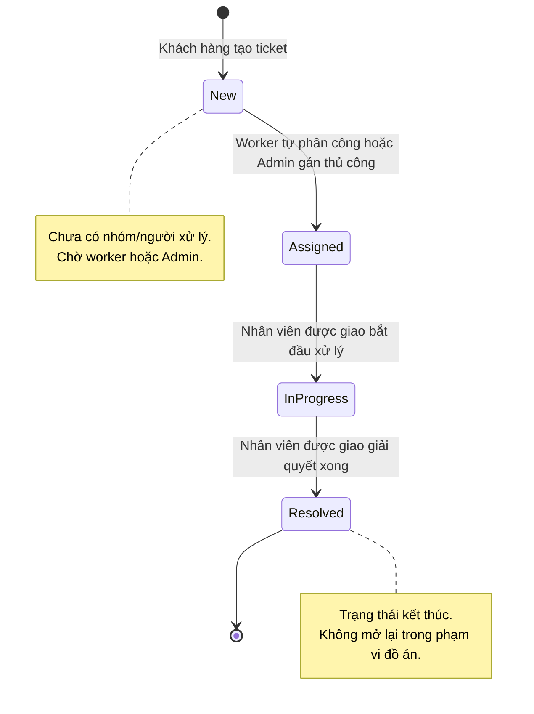

# W1-02 — Quy trình nghiệp vụ và quy tắc

> Tài liệu này là nguồn tham chiếu cho API, Worker, kiểm thử và giao diện.

## 1. Luồng nghiệp vụ chính

1. Khách hàng đăng nhập và gửi yêu cầu hỗ trợ.
2. Support API xác thực JWT, kiểm tra dữ liệu và lưu ticket trạng thái `New`.
3. API ghi lịch sử tạo ticket trong cùng transaction.
4. API publish sự kiện `TicketCreated` lên RabbitMQ.
5. Assignment Worker nhận thông điệp, xác định nhóm theo danh mục.
6. Worker lưu nhóm xử lý, chuyển ticket sang `Assigned` và ghi lịch sử trong cùng transaction.
7. Worker publish sự kiện `TicketAssigned`.
8. Notification Service nhận sự kiện và gửi thông báo qua SignalR cho đúng người.
9. Nhân viên được giao chuyển ticket sang `InProgress`, sau đó `Resolved`.
10. Mỗi thay đổi hợp lệ đều lưu lịch sử và phát sự kiện tương ứng.

## 2. Sơ đồ trạng thái

## 3. Bảng chuyển trạng thái hợp lệ

| Từ | Sang | Người thực hiện | Điều kiện |
|---|---|---|---|
| `New` | `Assigned` | Worker (tự động) hoặc Admin | Ticket chưa có nhóm; nhóm đích tồn tại |
| `Assigned` | `InProgress` | Staff được gán trực tiếp, Staff thuộc nhóm được giao, Admin | Ticket đang `Assigned` |
| `InProgress` | `Resolved` | Staff được gán trực tiếp, Staff thuộc nhóm được giao, Admin | Ticket đang `InProgress` |

Các chuyển đổi sau bị chặn và trả `409 Conflict`:

- Bỏ qua bước: `New → InProgress`, `New → Resolved`, `Assigned → Resolved`.
- Đi lùi: `InProgress → Assigned`, `Resolved → InProgress`, `Resolved → Assigned`.
- Chuyển sang chính trạng thái hiện tại (coi là không hợp lệ, trừ khi là thao tác phân công lại).
- Khách hàng tự đổi trạng thái (kể cả hủy ticket).

## 4. Quy tắc phân công

Worker chỉ dựa trên `Category` của ticket. Không dùng từ khóa mờ trong phiên bản 1.

| Danh mục | Nhóm xử lý | Mã nhóm |
|---|---|---|
| `Account` (tài khoản, đăng nhập) | Kỹ thuật | `TECH` |
| `Payment` (thanh toán, hóa đơn) | Kế toán | `ACCT` |
| `Delivery` (giao hàng, đổi trả) | Chăm sóc khách hàng | `CSKH` |
| `Other` hoặc giá trị không khớp | Hỗ trợ chung | `GENERAL` |

Quy tắc bổ sung:

- Mức ưu tiên không ảnh hưởng đến việc chọn nhóm trong phạm vi đồ án.
- Worker không tự chọn một nhân viên cụ thể; ticket được giao ở cấp nhóm (`AssignedTeamId`).
- Admin có thể gán thêm nhân viên cụ thể (`AssignedUserId`) ở tuần 4.
- Nếu không tìm thấy nhóm đích trong DB, worker không đánh dấu thành công; ghi log lỗi và để retry/DLQ.
- Phân công lại chỉ Admin thực hiện, chỉ khi ticket ở `Assigned` hoặc `InProgress`.

## 5. Ma trận phân quyền

| Hành động | Khách hàng | Nhân viên | Admin |
|---|---|---|---|
| Đăng nhập | Có | Có | Có |
| Tạo ticket | Có | Có | Có |
| Xem ticket do mình tạo | Có | Có | Có |
| Xem ticket được giao cho nhóm/mình | Không | Có | Có |
| Xem toàn bộ ticket | Không | Không | Có |
| Xem lịch sử ticket | Theo quyền xem ticket | Theo quyền xem ticket | Có |
| Chuyển `Assigned → InProgress` | Không | Có, nếu được giao | Có |
| Chuyển `InProgress → Resolved` | Không | Có, nếu được giao | Có |
| Phân công/gán lại nhóm, người | Không | Không | Có |
| Quản lý người dùng, nhóm | Không | Không | Có |

Quy tắc xác định danh tính:

- `CreatedByUserId`, `ChangedByUserId` lấy từ claim trong JWT.
- Client không được gửi `userId` để tự nhận là người khác; nếu có trường này trong body, API bỏ qua.
- `GET /users/{userId}/tickets`: khách hàng chỉ được gọi với chính mình; Admin gọi cho bất kỳ ai;
  nhân viên chỉ nhận kết quả trong phạm vi ticket được phép xem.

## 6. Quy tắc dữ liệu và kiểm tra hợp lệ

### 6.1. Trường bắt buộc khi tạo ticket

| Trường | Quy tắc |
|---|---|
| `title` | Bắt buộc, 5–200 ký tự sau khi trim |
| `description` | Bắt buộc, 10–4000 ký tự sau khi trim |
| `category` | Bắt buộc, một trong `Account`, `Payment`, `Delivery`, `Other` |
| `priority` | Không bắt buộc, mặc định `Medium`; một trong `Low`, `Medium`, `High` |
| `createdByUserId` | Không nhận từ client; lấy từ token |
| `status` | Luôn do server đặt là `New` |
| `assignedTeamId`, `assignedUserId` | Luôn `NULL` khi mới tạo |

### 6.2. Quy tắc chung

- Chuỗi được trim trước khi validate và lưu.
- Không chấp nhận danh mục/trạng thái/ưu tiên ngoài enum; trả `400 Bad Request`.
- Phân trang: `page ≥ 1`, `pageSize` từ 1 đến 100, mặc định 20.
- Không có API xóa ticket trong phạm vi đồ án.
- Ticket đã `Resolved` không được sửa trạng thái hay phân công.
- Cập nhật ticket và ghi lịch sử nằm trong cùng một transaction.
- Dùng `RowVersion` để phát hiện cập nhật đồng thời; xung đột trả `409 Conflict`.
- Lỗi validation trả cấu trúc `ProblemDetails` thống nhất.

## 7. Quy tắc lịch sử

Mỗi thay đổi nghiệp vụ tạo một bản ghi `TicketHistories`:

| Trường | Ý nghĩa |
|---|---|
| `TicketId` | Ticket bị thay đổi |
| `ChangedByUserId` | Người thực hiện; `NULL` nếu hệ thống/worker tự động |
| `FieldChanged` | `Status`, `AssignedTeamId`, `AssignedUserId`, `Priority`, `Category` |
| `OldValue` / `NewValue` | Giá trị trước/sau dạng chuỗi |
| `Note` | Ghi chú, ví dụ "Hệ thống tự động phân công" |
| `ChangedAt` | Thời điểm UTC |

- Ghi một dòng cho mỗi trường thay đổi.
- Lịch sử không được sửa hoặc xóa.
- API trả lịch sử theo thứ tự tăng dần theo `ChangedAt` để hiển thị tiến trình.
- Việc tạo ticket cũng ghi một dòng: `FieldChanged = Status`, `OldValue = NULL`, `NewValue = New`.

## 8. Quy tắc thông báo realtime

- Người nhận được xác định ở server từ quan hệ của ticket, không lấy từ client.
- Nhóm nhận:
  - Người tạo ticket.
  - Nhân viên được gán trực tiếp (nếu có).
  - Toàn bộ thành viên nhóm được giao (nếu có).
- Loại trừ người vừa thực hiện thay đổi để tránh thông báo thừa.
- Admin không nhận thông báo đẩy mặc định; Admin vẫn xem được dữ liệu qua API/giao diện.
- SignalR dùng group theo người (`user:{userId}`) và theo nhóm (`team:{teamId}`), gửi một lần cho mỗi kết nối sau khi hợp nhất danh sách.
- Nội dung thông báo chỉ gồm: `ticketId`, `ticketNumber`, `title`, `status`, `teamName`, `changedAt`;
  không gửi toàn bộ mô tả hay dữ liệu nhạy cảm.
- Nếu gửi thông báo lỗi, nghiệp vụ chính vẫn thành công; lỗi được ghi log để xử lý lại.

## 9. Sự kiện và hàng đợi (thiết kế cho tuần 3–6)

| Sự kiện | Routing key | Nội dung cốt lõi |
|---|---|---|
| `TicketCreated` | `ticket.created` | `messageId`, `version`, `ticketId`, `category`, `priority`, `createdByUserId`, `occurredAt` |
| `TicketAssigned` | `ticket.assigned` | `messageId`, `ticketId`, `teamId`, `assignedUserId?`, `occurredAt` |
| `TicketStatusChanged` | `ticket.status-changed` | `messageId`, `ticketId`, `oldStatus`, `newStatus`, `changedByUserId`, `occurredAt` |

- Exchange: `support-tickets` kiểu `topic`, durable.
- Queue: `assignment-worker` bind `ticket.created`.
- Queue: `notification-service` bind `ticket.assigned`, `ticket.status-changed`.
- Hàng đợi lỗi: `support-tickets-dlq` thông qua dead-letter exchange `support-tickets-dlx` (tuần 6).
- Mọi message có `MessageId` để chống xử lý trùng.

## 10. Trường hợp biên và cách xử lý

| Tình huống | Cách xử lý dự kiến |
|---|---|
| Worker đang tắt | Ticket vẫn ở `New`; Admin có thể gán thủ công; W6 bổ sung outbox/retry |
| RabbitMQ tạm mất kết nối khi tạo ticket | Ticket đã lưu vẫn hợp lệ; sự kiện được gửi lại nhờ outbox ở W6 |
| Thông điệp bị giao lại | Worker kiểm tra ticket đã `Assigned` thì bỏ qua, không ghi lịch sử trùng |
| Hai nhân viên cập nhật cùng lúc | `RowVersion` phát hiện xung đột, một request nhận `409` |
| Nhóm đích không tồn tại | Worker ghi log lỗi, không cập nhật ticket, để retry |
| Người dùng bị khóa | Không đăng nhập được; token cũ hết hạn theo thời gian sống ngắn |
| Danh mục lạ | API từ chối `400`; worker chỉ nhận dữ liệu đã hợp lệ |
| Không có người/nhóm khi `New` | Hợp lệ; đây là trạng thái chờ phân công |
| Gửi thông báo thất bại | Nghiệp vụ vẫn commit; log lỗi; có thể phát lại sự kiện |

## 11. Tiêu chí nghiệm thu nghiệp vụ

1. Không thể tạo ticket thiếu trường bắt buộc hoặc sai enum.
2. Ticket mới luôn ở `New`, không có nhóm/người xử lý.
3. Worker giao đúng 4 nhóm theo bảng phân công, kể cả nhánh mặc định `GENERAL`.
4. Mọi chuyển trạng thái sai thứ tự bị chặn với `409`.
5. Khách hàng không đọc hoặc cập nhật được ticket của người khác.
6. Mỗi thay đổi hợp lệ có đúng một bản ghi lịch sử tương ứng.
7. Thông báo chỉ đến người tạo, người được gán và thành viên nhóm xử lý.
